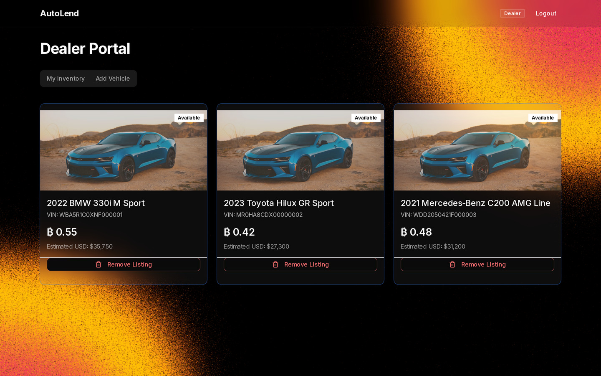
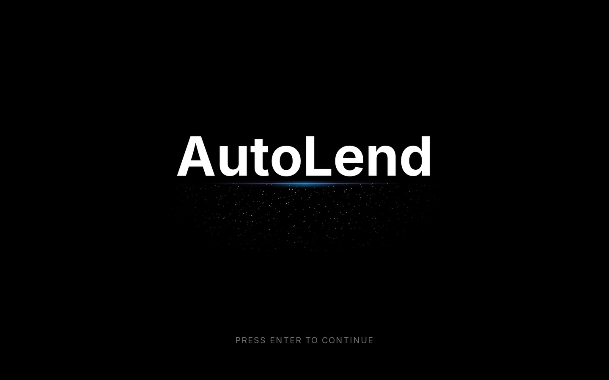
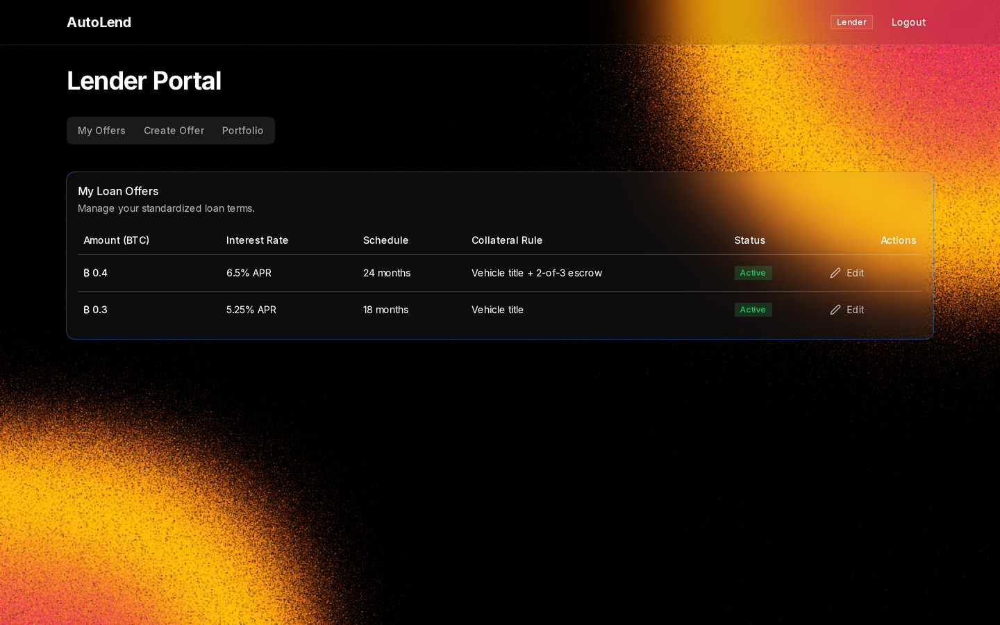
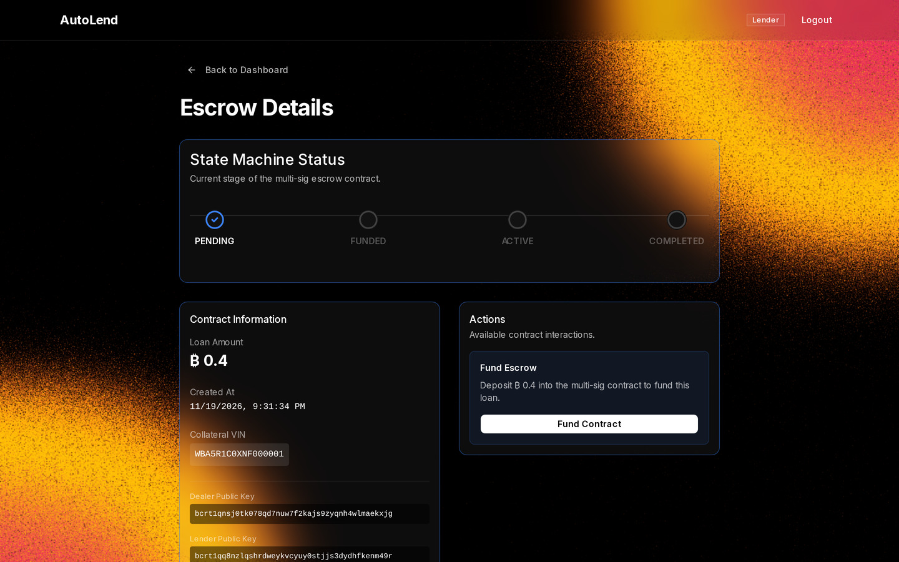

# AutoLend

Non-custodial peer-to-peer auto lending on Bitcoin RegTest: a dealer lists a car, a lender funds it, and the money sits in a 2-of-3 multisig escrow until delivery — with PSBTs built, signed and broadcast against a real `bitcoind`.



## How it fits together

```
┌────────────────────┐      HTTP + JWT      ┌──────────────────────┐
│  Next.js 14 (3000) │ ───────────────────▶ │  Express 5 API (5000)│
│  dealer/lender/    │                      │  Mongoose models     │
│  customer/escrow   │                      │  state machine       │
└────────────────────┘                      └──────────┬───────────┘
                                                       │ JSON over stdin
                                                       │ (child_process)
                                           ┌───────────▼───────────┐
                                           │  Rust bridge          │
                                           │  bdk + bitcoincore-rpc│
                                           │  2-of-3 P2WSH, PSBT   │
                                           └───────────┬───────────┘
                                                       │ JSON-RPC
                                           ┌───────────▼───────────┐
                                           │ bitcoind -regtest     │
                                           │ (18443)               │
                                           └───────────────────────┘
```

The backend never holds keys. It shells out to a Rust binary that generates wallets, builds the multisig script, and signs or broadcasts PSBTs. Lenders, dealers and customers each sign with their own descriptor.

## Stack

| Layer | What's used |
|---|---|
| Frontend | Next.js 14 (App Router), React 18, TypeScript, Tailwind, shadcn-style components, framer-motion, Paper Design shaders |
| API | Node 22, Express 5, Mongoose 9, JWT, express-validator |
| Chain bridge | Rust 2024, `bdk` 0.29, `bitcoin` 0.30, `bitcoincore-rpc` 0.17 |
| Node | Bitcoin Core `bitcoind` 25+ in RegTest mode |
| Dev DB | `mongodb-memory-server` (no local `mongod` needed) |

## Screens



| Dealer portal | Lender portal |
|---|---|
|  |  |



## How to run

Prerequisites: Node 18+, Rust 1.85+, Bitcoin Core 25+ (`bitcoind` and `bitcoin-cli` on `PATH`).

**Prep — build the bridge once:**

```bash
cd autolend-bitcoin
cargo build --release --features regtest
```

The `regtest` feature is required: without it the bridge does not connect to the local node.

**Terminal 1 — RegTest node + verification API:**

```bash
./scripts/setup-regtest.sh          # wipes ~/.bitcoin/regtest, starts bitcoind, mines 101 blocks
node scripts/esplora-regtest.mjs    # reads tx data from bitcoind on :3006
```

`setup-regtest.sh` enables `-txindex`, which the verification API needs to look up arbitrary transactions.

**Terminal 2 — backend:**

```bash
cd autolend-backend
npm ci
cp .env.example .env
npm start                            # http://localhost:5000
```

`NODE_ENV=development` starts an in-memory MongoDB, so nothing else needs installing. Data disappears when the server stops.

**Terminal 3 — frontend:**

```bash
cd autolend-frontend
npm ci
npm run dev                          # http://localhost:3000
```

Then open http://localhost:3000/auth and register three accounts, one per role (`dealer`, `lender`, `customer`). Each needs a real RegTest address — get one with:

```bash
bitcoin-cli -regtest -rpcuser=admin -rpcpassword=adminpass getnewaddress
```

**Check the chain layer on its own:**

```bash
./scripts/test-bitcoin-flow.sh
```

It walks the full path: create three wallets → fund → 2-of-3 multisig → fund escrow → build PSBT → dealer signs → customer signs → broadcast → mine → repay → check confirmations. It passes end to end on a clean RegTest node.

## What's real, what's mocked

**Real — executed against `bitcoind -regtest`:**

- Wallet generation, funding, block mining, balance queries.
- 2-of-3 P2WSH multisig construction. A CLTV timelock script builder (`create_timelocked_script`) exists as a separate bridge command but is not wired into the escrow flow.
- PSBT build → partial sign → second signature → broadcast, with two distinct signers.
- Repayment transactions and confirmation counting.
- Down-payment verification: the API reads the actual transaction and matches the dealer's address and amount. `scripts/test-bitcoin-flow.sh` and the screenshot data above both come from real RegTest transactions.
- Escrow state machine (`PENDING → FUNDED → ACTIVE → COMPLETED/DEFAULTED`) with tx-id reuse protection.

**Mocked or thin:**

- **Oracle is a mock.** `src/services/oracleMock.js` derives vehicle valuation and credit score from a SHA-256 of the VIN/customer id, and returns a hardcoded 5.5% market rate. It is deterministic, not a price feed.
- **Escrow funding is a recorded txid.** The lender supplies `fundingTxId` + `escrowAddress`; the server verifies the transaction but does not build the funding transaction itself.
- **The Esplora endpoint is a local translator.** `scripts/esplora-regtest.mjs` exposes read-only `tx`, `status` and `tip/height` from bitcoind. It is not a full Esplora instance.
- **Default protection is not automated.** The timelock script builder is available but unused; a defaulted loan needs the lender to call `liquidate` with a txid.
- **Auth is minimal.** JWT in `localStorage`, no refresh, no rate limiting, no password policy beyond 6 characters.
- **No backend test suite.** `npm test` is still the `exit 1` stub.
- **Vehicle images** are one static placeholder shared by every listing.
- RegTest only — no testnet or mainnet deployment, and no way for two real people to exchange PSBTs off-server.

## What I'd build next

1. **A real oracle path** — signed price attestations for the vehicle and a lender-set risk premium instead of hashed VINs.
2. **Escrow funding built client-side** — the lender's wallet constructs the funding tx from the multisig address, so the server only ever sees a `txid`.
3. **PSBT exchange between parties** — dealer and customer sign outside the server, with the API as coordinator and storage only.
4. **Tests where money moves** — state-machine transition tests, verification tests against a regtest fixture, and a CI job that runs `test-bitcoin-flow.sh`.
5. **Loan servicing** — repayment schedule instances, late fees, and automatic timelock liquidation instead of a manual lender action.

## Layout

```
autolend-frontend/   Next.js app (dealer, lender, customer, escrow, auth)
autolend-backend/    Express API, Mongoose models, Rust bridge wrapper
autolend-bitcoin/    Rust binary: wallets, multisig, PSBT, timelocks, RPC
scripts/             regtest setup, esplora shim, end-to-end chain test
docs/screenshots/    screenshots used above
```
